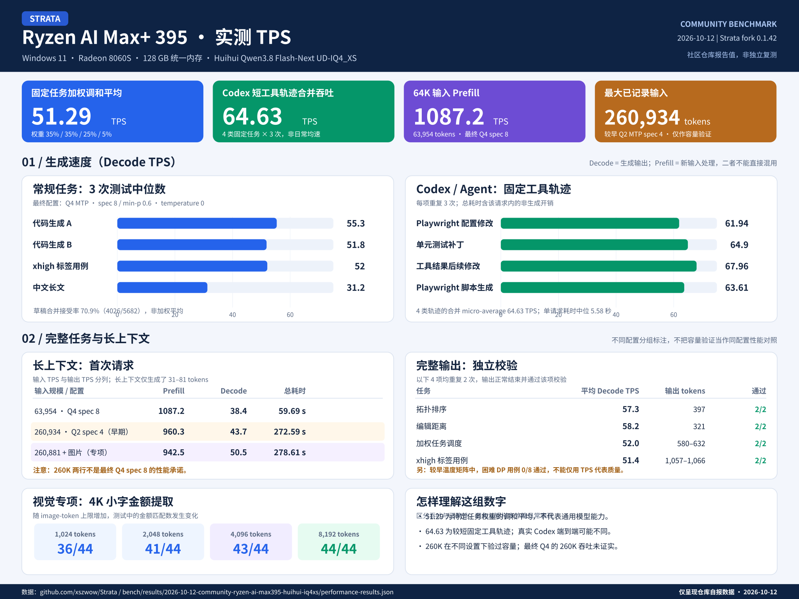

# Ryzen AI Max+ 395：Huihui IQ4_XS + Q4 MTP + 视觉完整部署

这是一套在 **Windows 11、AMD Ryzen AI Max+ 395、Radeon 8060S（`gfx1151`）、约 128 GB
统一内存**上实测过的 Strata 配置。目标是让 Codex、浏览器自动化、代码项目和长上下文会话能够直接使用：

- Huihui Qwen3.8 Flash-Next `UD-IQ4_XS` 主模型；
- 原生 `Q4_0` MTP，`spec 8 / spec-min-p 0.6 / window 8192`；
- 262K 总上下文、INT8 KV、6 份内存 prompt cache；
- Windows Vulkan 视觉编码器，单图 1,024～8,192 image tokens；
- OpenAI Chat Completions、Responses、Anthropic Messages 兼容接口；
- `codex_compaction_cache` 已开启。

本仓库**不包含约 95 GB 的模型文件**。下面的脚本会把模型放到你指定的数据目录，所有本机路径都在运行时计算，
没有写死原作者电脑的盘符或用户名。模型仓库、不可变 revision、文件大小和 SHA-256 则是有意固定的，保证下载到
与实测相同的权重；下载站点可以切换。

> 这不是官方 Strata 的通用一键安装页，而是这个 fork 的可复现部署。要使用原生 Q4 MTP 和 Windows
> Vulkan 视觉，必须克隆本 fork 并按顺序执行。当前 `main` 已包含所述补丁，无需指定历史功能分支。

## 1. 准备条件

推荐与实测机器尽量一致：

| 项目 | 要求 |
| --- | --- |
| 系统 | 64 位 Windows 10/11；实测为 Windows 11 |
| 处理器 / GPU | Ryzen AI Max+ 395 / Radeon 8060S，`gfx1151` |
| 内存 | 128 GB 统一内存档；约 125 GiB 可用 |
| 磁盘 | NVMe SSD，开始前至少留出 150 GB 空间 |
| AMD 驱动 | 当前版本 AMD Software: Adrenalin Edition |
| 构建工具 | Git、Python 3.10+、CMake、Ninja、Visual Studio 2022 Build Tools 的“使用 C++ 的桌面开发”工作负载 |
| 视觉组件 | [LunarG Vulkan SDK](https://vulkan.lunarg.com/sdk/home#windows)，安装后重新打开终端 |
| 虚拟内存 | 建议保持“系统管理”，或手动给足 64 GB 以上 pagefile，避免 Windows commit limit 不足 |

其他 Radeon、内存容量或驱动版本可以尝试，但缓存规模、稳定性和 TPS 需要重新验证，不能直接套用本文的速度结论。

## 2. 克隆这个分支并定义目录

在 PowerShell 中运行：

```powershell
git clone https://github.com/xszwow/Strata.git
Set-Location .\Strata

$RepoRoot = (Get-Location).Path
$DataRoot = Join-Path (Split-Path $RepoRoot -Parent) 'Strata-data-huihui'
$Guide = Join-Path $RepoRoot 'bench\results\2026-10-12-community-ryzen-ai-max395-huihui-iq4xs'
```

`$DataRoot` 只是默认示例：要把 100 GB 以上的数据放到别的 SSD，改这一行即可，后续命令不需要再改路径。

## 3. 下载并校验主模型和视觉 projector

直连 Hugging Face：

```powershell
& "$Guide\Get-Models.ps1" -DataRoot $DataRoot
```

中国大陆网络可改用镜像；如果 Clash 更稳定，也可以保留默认站点并让 PowerShell 走你的系统代理：

```powershell
& "$Guide\Get-Models.ps1" -DataRoot $DataRoot -Endpoint 'https://hf-mirror.com'
```

脚本使用 `.part` 临时文件并支持断点续传。每个文件下载后都会核对大小和 SHA-256；中断后重新运行同一条命令即可。
只想先看 URL、目标路径和哈希而不下载，可加 `-ListOnly`。

下载结果位于：

```text
<DataRoot>\models\huihui-ud-iq4-xs\*.gguf
<DataRoot>\models\vision\mmproj-Qwen3.8-Flash-Next-BF16.gguf
```

## 4. 构建并安装这个分支的 HIP 引擎

原生 Q4 MTP 是这个 fork 的源码改动，不能用上游旧的预编译引擎代替。在仓库根目录运行：

```powershell
& .\tools\hip\build_windows.bat
```

首次构建会下载私有 ROCm/TheRock 构建环境，大约占 7 GB，并生成：

```text
dist\strata-windows-x64-hip.zip
```

然后让 Strata 用本地 GGUF 和刚构建的引擎完成基础安装。此步骤会创建 `.venv`、准备主模型 pack，并生成一份
基础 JSON 配置；视觉先选 `no`，稍后换成本分支的 Vulkan 视觉组件：

```powershell
$MainModelDir = Join-Path $DataRoot 'models\huihui-ud-iq4-xs'

& .\START-HERE.bat `
  --backend hip `
  --prebuilt .\dist\ `
  --family unsloth `
  --model UD-IQ4_XS `
  --context 262144 `
  --vision no `
  --gguf-dir $MainModelDir `
  --data-dir $DataRoot `
  --no-start `
  --yes
```

如果 Windows 阻止本地编译出的程序运行，在“Windows 安全中心 → 应用和浏览器控制”中查看拦截记录；不要从未知来源
下载同名可执行文件替换它。

## 5. 制作原生 Q4_0 MTP

默认使用 Hugging Face 的 range request，只下载原始 Qwen checkpoint 中 MTP 所需的张量，不会下载整个
BF16 模型：

```powershell
& "$Guide\Prepare-Q4Mtp.ps1" -DataRoot $DataRoot
```

需要镜像时，先在当前 PowerShell 会话设置端点：

```powershell
$env:HF_ENDPOINT = 'https://hf-mirror.com'
& "$Guide\Prepare-Q4Mtp.ps1" -DataRoot $DataRoot
Remove-Item Env:HF_ENDPOINT
```

镜像必须正确支持 HTTP Range。脚本会核对 31 个源张量，并依次运行 `mtp_pack.py --experts q4_0` 和
`mtp_rt.py`。完成目录是：

```text
<DataRoot>\models\strata\mtp-rt-q4_0
```

其中必须有 `dense.bin`、`dense.txt`、`draft_vocab.bin`、`experts.bin` 和 `experts.txt`。这里不能换成单个
llama.cpp MTP GGUF。

## 6. 构建 Windows Vulkan 视觉组件

安装 Vulkan SDK 后，打开 **Developer PowerShell for VS 2022**，进入同一个仓库根目录，再运行：

```powershell
& "$Guide\Build-Vision-Vulkan.ps1" -Jobs 12
```

默认输出：

```text
build-vision-vulkan\bin\strata-vision.exe
```

这个 fork 包含高 image-token cap 的 GPU warm-up 修正。若不需要看图，可以跳过本节，但生成配置时仍需去掉
`--vision` 和 `vision` 对象；当前自动配置脚本按“启用视觉”生成。

## 7. 生成不含硬编码路径的本机配置

下面会自动选取第 4 步刚生成、最近修改的基础配置，并将所有路径解析为你电脑上的实际位置：

```powershell
$BaseConfig = Get-ChildItem $RepoRoot -Filter 'strata-*.json' |
  Where-Object { $_.Name -notlike '*.shared-settings.json' -and $_.Name -ne 'strata-huihui-iq4xs-q4mtp.json' } |
  Sort-Object LastWriteTime -Descending |
  Select-Object -First 1

if (-not $BaseConfig) { throw '没有找到 START-HERE.bat 生成的基础配置' }

$MtpRuntime = Join-Path $DataRoot 'models\strata\mtp-rt-q4_0'
$VisionExe = Join-Path $RepoRoot 'build-vision-vulkan\bin\strata-vision.exe'
$VisionMmproj = Join-Path $DataRoot 'models\vision\mmproj-Qwen3.8-Flash-Next-BF16.gguf'
$Config = Join-Path $RepoRoot 'strata-huihui-iq4xs-q4mtp.json'

& "$Guide\New-LocalConfig.ps1" `
  -BaseConfig $BaseConfig.FullName `
  -MtpRuntime $MtpRuntime `
  -VisionExe $VisionExe `
  -VisionMmproj $VisionMmproj `
  -OutputPath $Config
```

如果仓库里原本就装了多个模型，不要依赖“最近修改”；把 `$BaseConfig` 手动设为本次
`UD-IQ4_XS` 安装生成的 JSON 文件即可。

生成结果保留基础配置里的 HIP 引擎、tokenizer 和主模型路径，同时写入这组已测参数：

| 参数 | 值 |
| --- | --- |
| 上下文 / KV | 262,144 / INT8 |
| 并发生成 | 1（8 个 worker 是内部 worker pool，不是 8 路满速并发） |
| Prefill chunk | 16,384 |
| Expert cache | 24,576 |
| Prompt cache | 6 个内存 checkpoint |
| Host conversation parking | 关闭，`0 MiB` |
| MTP | Q4_0、`spec 8`、`spec-min-p 0.6`、window 8,192 |
| Sampling | temperature 0、top-p 0.95、top-k 20、seed 12345 |
| Codex compaction cache | 开启 |
| `lookup-chain` | 关闭；实测真实工具轨迹平均慢约 0.85% |
| Vision | Vulkan GPU，1,024～8,192 image tokens，16 threads |

## 8. 启动、检查和接入

启动服务：

```powershell
& "$Guide\Start-Local.ps1" -ConfigPath $Config
```

看到服务 ready 后，新开一个 PowerShell 检查：

```powershell
Invoke-RestMethod 'http://127.0.0.1:8080/health' | ConvertTo-Json -Depth 8
Invoke-RestMethod 'http://127.0.0.1:8080/v1/models' | ConvertTo-Json -Depth 8
```

`/health` 应显示 `status: ok`、`loaded: true`、`images: true` 和 `max_context: 262144`。浏览器页面是
<http://127.0.0.1:8080>，停止服务按 `Ctrl+C`。

应用或 Codex 的连接参数：

| 项目 | 值 |
| --- | --- |
| OpenAI base URL | `http://127.0.0.1:8080/v1` |
| Chat Completions | `POST /v1/chat/completions` |
| Responses / Codex | `POST /v1/responses` |
| Anthropic-compatible | `http://127.0.0.1:8080/v1/messages` |
| API key | 仅限本机监听时可填任意非空字符串 |
| Model | `huihui-qwen3.8-flash-next-iq4-xs` |

不要把无 API key 的 `127.0.0.1` 服务直接暴露到局域网或公网。需要远程访问时，请按主文档配置 `--host` 和
强 API key。

## 实测速度与适用范围



**统计与复现边界：**数据是当前仓库发布的聚合测试记录，尚非第三方独立复测。`xhigh` 为测试用例标签，不是云端模型同名推理档位的等价证明。综合 51.29 TPS 是按代码 A 35%、代码 B 35%、xhigh 25%、中文 5% 计算的加权调和平均；Codex 64.63 TPS 是固定短工具轨迹的合并生成吞吐，不能当作任意 Codex 工程任务的端到端速度。近 260K 的测试属于不同阶段的容量或视觉专项验证，并非最终 Q4 spec 8 配置在 260K 下的等条件速度证明。当前记录的长上下文任务每项只生成 31～81 tokens，尚未验证 260K 输入后长时间连续生成的表现。


这里分别报告 **prefill（新输入处理）**和 **decode（生成输出）**。除非另有说明，下面的当前配置成绩均使用
Q4 MTP、`spec 8`、`spec-min-p 0.6`、temperature 0、prefill 16,384；完整聚合数据保存在
[`performance-results.json`](performance-results.json)。同配置电脑也会受内存频率、BIOS、驱动、后台程序、散热和
prompt 内容影响，以下数字不是速度保证。

### 不同类型的常规输出 TPS

这组用于固定负载的吞吐筛选，每种提示重复 3 次、每次最多输出 512 token；表中为 decode TPS 中位数和 3 次范围。所有请求的
实际 temperature 都是 0，`sampled` 只是测试用例的历史名称。

| 固定用例 | 类型 | 中位 TPS | 3 次范围 | MTP 接受率 |
| --- | --- | ---: | ---: | ---: |
| `code_greedy` | 代码生成 A | **55.3** | 55.0～55.4 | 71.7% |
| `code_sampled` | 代码生成 B | **51.8** | 51.8～52.1 | 75.4% |
| `xhigh_throughput` | 长推理 / xhigh | **52.0** | 51.7～52.3 | 71.3% |
| `chinese_sampled` | 中文长文 | **31.2** | 31.1～31.4 | 60.8% |
| 加权调和平均 | 代码 A 35%、代码 B 35%、xhigh 25%、中文 5% | **51.29** | — | 总体 70.9% |

这说明“代码通常约 52～55 TPS、长推理约 52 TPS、中文约 31 TPS”比笼统写“60～65 TPS”更接近日常情况。
上表是吞吐筛选，512 token 到上限的请求不等于完整任务正确。

### 完整输出并通过正确性检查的 TPS

以下任务不是 512 token 截断：每项重复 2 次，全部正常 `stop`，并通过独立结果校验。

| 任务 | 输出规模 | 两次 decode TPS | 平均 TPS | 通过 |
| --- | ---: | ---: | ---: | ---: |
| 拓扑排序代码 | 397 tokens/次 | 56.6、58.0 | **57.3** | 2/2 |
| 编辑距离代码 | 321 tokens/次 | 57.8、58.6 | **58.2** | 2/2 |
| 加权任务调度代码 | 580～632 tokens | 49.3、54.6 | **52.0** | 2/2 |
| xhigh 推理 | 1,057～1,066 tokens | 50.7、52.1 | **51.4** | 2/2 |

日常生产配置另做了一次 smoke test：代码生成 **59.7 TPS**、202 tokens，11 项输入检查全部通过；完整 xhigh
为 **52.8 TPS**、1,592 tokens，正常结束。这两个是单次值，不能当中位数。

### Codex、工具调用和 Playwright TPS

4 个固定 Codex 工具轨迹各重复 3 次，工具调用格式和任务结果全部通过：

| 用例 | 中位 TPS | 3 次范围 | 中位总等待 |
| --- | ---: | ---: | ---: |
| Playwright 配置修改 | 61.94 | 59.74～62.50 | 4.25 秒 |
| 单元测试补丁 | 64.90 | 64.46～65.19 | 7.61 秒 |
| 工具结果后的继续修改 | **67.96** | 65.26～68.40 | 6.42 秒 |
| Playwright 脚本生成 | 63.61 | 63.17～63.78 | 4.11 秒 |
| 12 次合并 micro-average | **64.63** | — | 单请求中位 5.58 秒 |

这组 64.63 TPS 是偏短、投机命中较好的固定工具任务，**有 tool calls，但 `--lookup-chain` 关闭**，不能代表普通
中文或任意长推理。对同一组轨迹开启 `--lookup-chain 3` 后是 64.08 TPS，整体 **下降 0.85%**；lookup token
虽然接受了 19/29，但只有 18/460 个窗口实际使用，因此生产配置继续关闭它。

### 长上下文：输入 TPS 与输出 TPS

| 输入规模与配置 | Prefill TPS | Decode TPS | 总等待 | 结果 |
| --- | ---: | ---: | ---: | --- |
| 63,954 tokens，当前 `spec 8 / 0.6` | **1,087.2** | 38.4（31 tokens） | 59.69 秒 | 3 个标记全部找回 |
| 260,934 tokens，较早 `spec 4 / Q2 MTP` 容量验证 | **960.3** | 43.7（31 tokens） | 272.59 秒 | 3 个标记全部找回 |
| 260,881 tokens + 图片，最终视觉配置 | **942.5** | 50.5（81 tokens） | 278.61 秒 | 3 个标记和图片六行文字全部正确 |

第二、三行属于较早配置或视觉专项验证，只证明容量与当时的实测速度，不能冒充当前 `spec 8 / 0.6` 的正面对比。
视觉近满上下文的相同请求第二次复用了 260,874 tokens，只新读 7 tokens，总等待约 1.89 秒。

<details>
<summary><b>temperature 0 / 0.3 / 0.6 / 1.0 重复测试</b></summary>

这组使用较早的 Q4 MTP `spec 7 / spec-min-p 0.55`，每格重复 2 次，表中是两次 decode TPS 的平均值。
它用来观察温度影响，不能与上面的最终 `spec 8 / 0.6` 成绩直接混排。

| Temperature | 普通 xhigh | 加权调度代码 | 困难 DP 长推理 | 正确性 |
| ---: | ---: | ---: | ---: | --- |
| 0.0 | 51.45 | 49.75 | 37.85 | 前两项 2/2；困难 DP 0/2 |
| 0.3 | **53.95** | 50.75 | 36.95 | 前两项 2/2；困难 DP 0/2 |
| 0.6 | 50.55 | **54.35** | 35.95 | 前两项 2/2；困难 DP 0/2 |
| 1.0 | 48.25 | 50.95 | 33.50 | 前两项 2/2；困难 DP 0/2 |

温度改变了生成路径、输出长度和 MTP 接受率，所以不同问题的最快温度不同。困难 DP 虽然都正常结束，但 8 次答案
都没有通过独立 DP 校验；其 TPS 只能算失败样本的速度，不能当作有效质量成绩。这也是生产配置选择 temperature 0，
而不是单看某一格峰值的原因。

</details>

<details>
<summary><b>视觉精度、等待时间与文字 TPS 对照</b></summary>

4K 小字表格包含 44 个随机金额，每档重复 2 次：

| Image-token 上限 | 正确金额 | 两次 Prefill TPS | 两次 Decode TPS | 首次 / 第二次总等待 |
| ---: | ---: | ---: | ---: | ---: |
| 1,024 | 36/44 | 622.8 / 688.6 | 56.0 / 56.1 | 10.92 / 9.59 秒 |
| 2,048 | 41/44 | 759.5 / 808.6 | 56.7 / 57.0 | 13.88 / 10.45 秒 |
| 4,096 | 43/44 | 995.6 / 1,006.6 | 63.1 / 63.3 | 19.47 / 11.30 秒 |
| 8,192 | **44/44** | 1,040.7 / 1,067.5 | 60.5 / 61.6 | 41.88 / 15.20 秒 |

接入 Vulkan 视觉前后，512-token 文字吞吐分别为：代码 A 51.7 → 52.6 TPS、代码 B 49.7 → 49.6 TPS、xhigh
44.9 → 45.7 TPS。差异均在约 2% 内，未观察到有意义的文字性能损失。图片任务更适合报告端到端等待时间，不能把
图片编码秒数写成 decode TPS。

</details>

不同问题会改变 MTP 接受率、MoE 路由、思考长度和输出结构，因此出现 30～60+ TPS 波动是正常的。尤其不要把
Codex 短工具题的 64.63 TPS 当成所有任务的持续速度。

## 缓存到底有什么

- 6 个 prompt cache checkpoint 在内存中，可复用相同长前缀；
- `codex_compaction_cache: true` 可复用匹配的 Codex compaction。一次受控 smoke test 中，2,410 个输入 token
  复用了 2,383 个，耗时 1.046 秒；关闭时为 3.328 秒；
- 没有磁盘持久化 KV，也不能在 Strata 重启后恢复 KV；
- host RAM conversation parking 当前关闭；
- 这些设置不会创建 Halogen 风格的 256 GiB 磁盘 KV lineage。

## 常见问题

### 报错不支持 Q4 MTP，或 `experts.txt` 缺失

确认使用的是本 fork 自己构建的 `dist\strata-windows-x64-hip.zip`，不要被 `START-HERE.bat` 换回上游旧引擎。
然后重新运行第 5 步；脚本会验证 Q4 runtime 的 5 个必需文件。

### `/health` 中 `images` 是 `false`

检查 `build-vision-vulkan\bin\strata-vision.exe` 和 mmproj 是否存在，然后重新执行第 7 步生成配置。视觉组件必须
用 Vulkan SDK 构建，不能拿通用 Windows HIP 包里缺失或旧的视觉程序代替。

### 下载慢或断开

主模型脚本可以在 `huggingface.co` 与 `hf-mirror.com` 间切换，并会保留 `.part`。MTP 下载使用 HTTP Range；
若镜像不支持正确的 206/`Content-Range`，请改回 Hugging Face 并通过 Clash 代理访问。

### 启动时内存不足或系统卡死

关闭大型浏览器、游戏和其他 GPU 程序，检查 pagefile 与 Windows commit limit。这里是统一内存机器，模型、KV、GPU
分配和系统进程共享同一池内存，“显存看起来还有”不等于 commit 一定足够。

### 有多个 JSON，不知道该启动哪个

本文最终配置固定命名为 `strata-huihui-iq4xs-q4mtp.json`。`Start-Local.ps1` 默认也寻找这个文件；第 4 步生成的
基础 JSON 只用于保留安装器检测出的引擎和模型路径。

## 文件与来源记录

| 文件 | 用途 |
| --- | --- |
| [`Get-Models.ps1`](Get-Models.ps1) | 可换 endpoint、可续传、带 SHA-256 的主模型与 mmproj 下载器 |
| [`Prepare-Q4Mtp.ps1`](Prepare-Q4Mtp.ps1) | 下载并验证 MTP 张量，打包原生 Q4_0 runtime |
| [`Build-Vision-Vulkan.ps1`](Build-Vision-Vulkan.ps1) | 构建 Windows Vulkan 视觉组件 |
| [`New-LocalConfig.ps1`](New-LocalConfig.ps1) | 从本机基础配置生成生产配置，不携带原作者绝对路径 |
| [`Start-Local.ps1`](Start-Local.ps1) | 启动 OpenAI/Anthropic 兼容服务 |
| [`models.json`](models.json) | 模型 revision、大小、哈希和产物哈希 |
| [`mtp-source-manifest.json`](mtp-source-manifest.json) | 31 个 BF16 MTP 源张量的范围与哈希 |
| [`codex-compaction-cache.json`](codex-compaction-cache.json) | compaction cache smoke test 原始记录 |
| [`performance-results.json`](performance-results.json) | 不同题型、工具调用、温度、长上下文与视觉测试的聚合数据 |

主要权重来自
[`huihui-ai/Huihui-Qwen3.8-Flash-Next-abliterated-GGUF`](https://huggingface.co/huihui-ai/Huihui-Qwen3.8-Flash-Next-abliterated-GGUF)，
MTP 源张量来自
[`Qwen/Qwen3.8-Flash-Next`](https://huggingface.co/Qwen/Qwen3.8-Flash-Next)。各模型和源仓库的许可证仍然适用。
