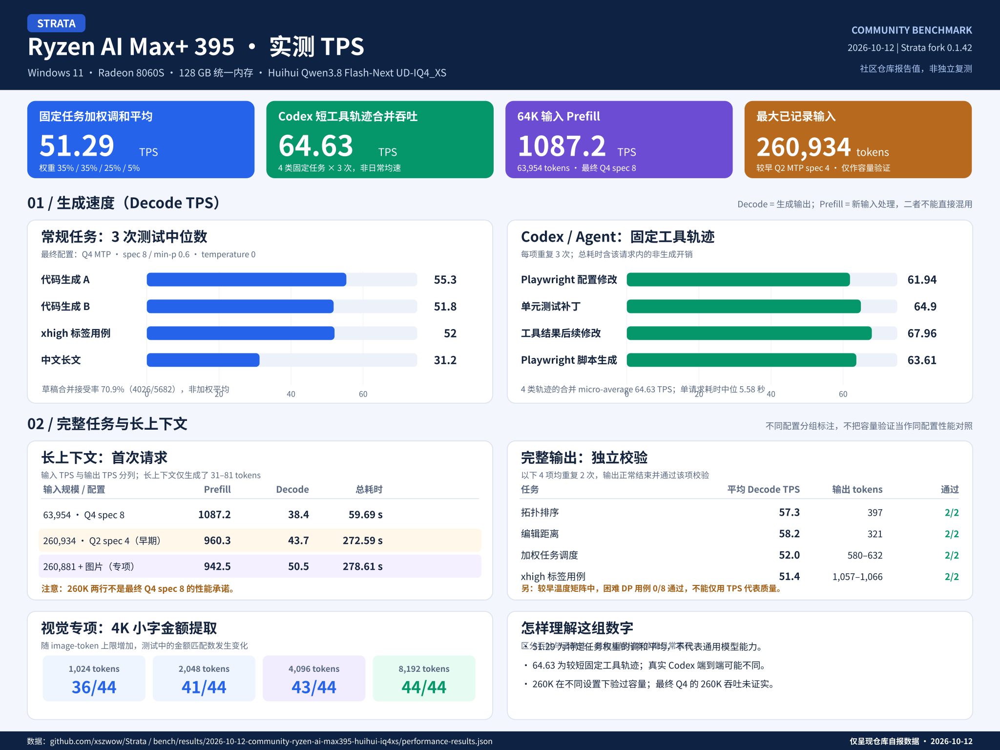

# 历史测试归档：2026 年 10 月 Ryzen AI Max+ 395

本目录保留 10 月测试的原始数据、模型来源、图片和报告。下方速度、配置和限制属于对应历史批次。
**当前版本为源码 0.2.10 / 引擎 0.1.56。** 安装说明已迁至 [当前安装指南](../../../docs/WINDOWS_RYZEN_AI_MAX395.md)，安装脚本位于 [deploy/windows-gfx1151](../../../deploy/windows-gfx1151/)。

[11 月 4 日新版对照报告](../2026-11-04-community-ryzen-ai-max395-engine0156/README.md) · [全部本机测试归档](../../../docs/BENCHMARK_ARCHIVE.md)

## 实测速度与适用范围

**统计与复现边界：**数据是当时仓库发布的聚合测试记录，尚非第三方独立复测。`xhigh` 为测试用例标签，不是云端模型同名推理档位的等价证明。综合 51.29 TPS 是按代码 A 35%、代码 B 35%、xhigh 25%、中文 5% 计算的加权调和平均；Codex 64.63 TPS 是固定短工具轨迹的合并生成吞吐，不能当作任意 Codex 工程任务的端到端速度。近 260K 的测试属于不同阶段的容量或视觉专项验证，并非最终 Q4 spec 8 配置在 260K 下的等条件速度证明。当时记录的长上下文任务每项只生成 31～81 tokens，尚未验证 260K 输入后长时间连续生成的表现。

这里分别报告 **prefill（新输入处理）**和 **decode（生成输出）**。除非另有说明，下面的当时配置成绩均使用
Q4 MTP、`spec 8`、`spec-min-p 0.6`、temperature 0、prefill 16,384；完整聚合数据保存在
[`performance-results.json`](performance-results.json)。同配置电脑也会受内存频率、BIOS、驱动、后台程序、散热和
prompt 内容影响，以下数字不是速度保证。

### 不同类型的常规输出 TPS

这组用于固定负载的吞吐筛选，每种提示重复 3 次、每次最多输出 512 token；表中为 decode TPS 中位数和 3 次范围。所有请求的
实际 temperature 都是 0，`sampled` 只是测试用例的历史名称。

| 固定用例 | 类型 | 中位 TPS | 3 次范围 | MTP 接受率 |
| --- | --- | ---: | ---: | ---: |
| `code_greedy` | 代码生成 A | **55.3** | 55.0～55.4 | 71.7% |
| `code_sampled` | 代码生成 B | **51.8** | 51.8～52.1 | 75.4% |
| `xhigh_throughput` | 长推理 / xhigh | **52.0** | 51.7～52.3 | 71.3% |
| `chinese_sampled` | 中文长文 | **31.2** | 31.1～31.4 | 60.8% |
| 加权调和平均 | 代码 A 35%、代码 B 35%、xhigh 25%、中文 5% | **51.29** | — | 总体 70.9% |

这说明“代码通常约 52～55 TPS、长推理约 52 TPS、中文约 31 TPS”比笼统写“60～65 TPS”更接近日常情况。
上表是吞吐筛选，512 token 到上限的请求不等于完整任务正确。

### 完整输出并通过正确性检查的 TPS

以下任务不是 512 token 截断：每项重复 2 次，全部正常 `stop`，并通过独立结果校验。

| 任务 | 输出规模 | 两次 decode TPS | 平均 TPS | 通过 |
| --- | ---: | ---: | ---: | ---: |
| 拓扑排序代码 | 397 tokens/次 | 56.6、58.0 | **57.3** | 2/2 |
| 编辑距离代码 | 321 tokens/次 | 57.8、58.6 | **58.2** | 2/2 |
| 加权任务调度代码 | 580～632 tokens | 49.3、54.6 | **52.0** | 2/2 |
| xhigh 推理 | 1,057～1,066 tokens | 50.7、52.1 | **51.4** | 2/2 |

日常生产配置另做了一次 smoke test：代码生成 **59.7 TPS**、202 tokens，11 项输入检查全部通过；完整 xhigh
为 **52.8 TPS**、1,592 tokens，正常结束。这两个是单次值，不能当中位数。

### Codex、工具调用和 Playwright TPS

4 个固定 Codex 工具轨迹各重复 3 次，工具调用格式和任务结果全部通过：

| 用例 | 中位 TPS | 3 次范围 | 中位总等待 |
| --- | ---: | ---: | ---: |
| Playwright 配置修改 | 61.94 | 59.74～62.50 | 4.25 秒 |
| 单元测试补丁 | 64.90 | 64.46～65.19 | 7.61 秒 |
| 工具结果后的继续修改 | **67.96** | 65.26～68.40 | 6.42 秒 |
| Playwright 脚本生成 | 63.61 | 63.17～63.78 | 4.11 秒 |
| 12 次合并 micro-average | **64.63** | — | 单请求中位 5.58 秒 |

这组 64.63 TPS 是偏短、投机命中较好的固定工具任务，**有 tool calls，但 `--lookup-chain` 关闭**，不能代表普通
中文或任意长推理。对同一组轨迹开启 `--lookup-chain 3` 后是 64.08 TPS，整体 **下降 0.85%**；lookup token
虽然接受了 19/29，但只有 18/460 个窗口实际使用，因此生产配置继续关闭它。

### 长上下文：输入 TPS 与输出 TPS

| 输入规模与配置 | Prefill TPS | Decode TPS | 总等待 | 结果 |
| --- | ---: | ---: | ---: | --- |
| 63,954 tokens，当时 `spec 8 / 0.6` | **1,087.2** | 38.4（31 tokens） | 59.69 秒 | 3 个标记全部找回 |
| 260,934 tokens，较早 `spec 4 / Q2 MTP` 容量验证 | **960.3** | 43.7（31 tokens） | 272.59 秒 | 3 个标记全部找回 |
| 260,881 tokens + 图片，最终视觉配置 | **942.5** | 50.5（81 tokens） | 278.61 秒 | 3 个标记和图片六行文字全部正确 |

第二、三行属于较早配置或视觉专项验证，只证明容量与当时的实测速度，不能冒充当时 `spec 8 / 0.6` 的正面对比。
视觉近满上下文的相同请求第二次复用了 260,874 tokens，只新读 7 tokens，总等待约 1.89 秒。

<b>temperature 0 / 0.3 / 0.6 / 1.0 重复测试</b>

这组使用较早的 Q4 MTP `spec 7 / spec-min-p 0.55`，每格重复 2 次，表中是两次 decode TPS 的平均值。
它用来观察温度影响，不能与上面的最终 `spec 8 / 0.6` 成绩直接混排。

| Temperature | 普通 xhigh | 加权调度代码 | 困难 DP 长推理 | 正确性 |
| ---: | ---: | ---: | ---: | --- |
| 0.0 | 51.45 | 49.75 | 37.85 | 前两项 2/2；困难 DP 0/2 |
| 0.3 | **53.95** | 50.75 | 36.95 | 前两项 2/2；困难 DP 0/2 |
| 0.6 | 50.55 | **54.35** | 35.95 | 前两项 2/2；困难 DP 0/2 |
| 1.0 | 48.25 | 50.95 | 33.50 | 前两项 2/2；困难 DP 0/2 |

温度改变了生成路径、输出长度和 MTP 接受率，所以不同问题的最快温度不同。困难 DP 虽然都正常结束，但 8 次答案
都没有通过独立 DP 校验；其 TPS 只能算失败样本的速度，不能当作有效质量成绩。这也是生产配置选择 temperature 0，
而不是单看某一格峰值的原因。

<b>视觉精度、等待时间与文字 TPS 对照</b>

4K 小字表格包含 44 个随机金额，每档重复 2 次：

| Image-token 上限 | 正确金额 | 两次 Prefill TPS | 两次 Decode TPS | 首次 / 第二次总等待 |
| ---: | ---: | ---: | ---: | ---: |
| 1,024 | 36/44 | 622.8 / 688.6 | 56.0 / 56.1 | 10.92 / 9.59 秒 |
| 2,048 | 41/44 | 759.5 / 808.6 | 56.7 / 57.0 | 13.88 / 10.45 秒 |
| 4,096 | 43/44 | 995.6 / 1,006.6 | 63.1 / 63.3 | 19.47 / 11.30 秒 |
| 8,192 | **44/44** | 1,040.7 / 1,067.5 | 60.5 / 61.6 | 41.88 / 15.20 秒 |

接入 Vulkan 视觉前后，512-token 文字吞吐分别为：代码 A 51.7 → 52.6 TPS、代码 B 49.7 → 49.6 TPS、xhigh
44.9 → 45.7 TPS。差异均在约 2% 内，未观察到有意义的文字性能损失。图片任务更适合报告端到端等待时间，不能把
图片编码秒数写成 decode TPS。

不同问题会改变 MTP 接受率、MoE 路由、思考长度和输出结构，因此出现 30～60+ TPS 波动是正常的。尤其不要把
Codex 短工具题的 64.63 TPS 当成所有任务的持续速度。

## 缓存到底有什么

- 6 个 prompt cache checkpoint 在内存中，可复用相同长前缀；
- `codex_compaction_cache: true` 可复用匹配的 Codex compaction。一次受控 smoke test 中，2,410 个输入 token
  复用了 2,383 个，耗时 1.046 秒；关闭时为 3.328 秒；
- 没有磁盘持久化 KV，也不能在 Strata 重启后恢复 KV；
- host RAM conversation parking 当时关闭；
- 这些设置不会创建 Halogen 风格的 256 GiB 磁盘 KV lineage。

## 保留的数据

| 文件 | 内容 |
| --- | --- |
| [performance-results.json](performance-results.json) | 历史速度、温度、上下文与视觉数据 |
| [tps-infographic.svg](tps-infographic.svg) | 对应本批数据的历史信息图 |
| [codex-compaction-cache.json](codex-compaction-cache.json) | 当时的缓存测试记录 |
| [models.json](models.json) | 沿用至当前部署的主模型与视觉文件来源 |
| [mtp-source-manifest.json](mtp-source-manifest.json) | MTP 源张量范围与哈希 |
