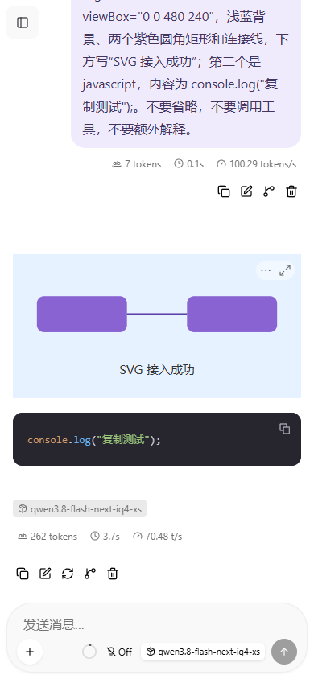
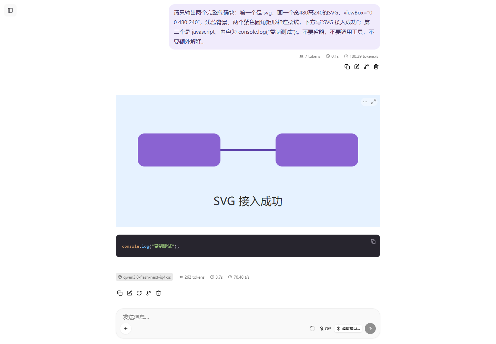

# IVYUN SVG 与代码块操作验证

2026-11-13 已将 SVG 预览和代码复制发布到实际使用的公网 IVYUN。静态版本为 `78e571395892170f`。这项改动属于独立部署的 IVYUN，Strata 的模型、推理参数和内置网页没有随之更改。

## 使用方式

- SVG：模型输出完整的 `svg` 代码块即可预览，包含 SVG 的 `xml` 代码块也支持。图内右上角的菜单可查看/收起源码、复制源码、下载矢量 SVG、导出 PNG、下载原始源码文本；旁边的展开按钮支持拖动、缩放和适应屏幕。
- 普通代码：右上角的复制图标复制完整代码，保留缩进和特殊字符。正在生成时复制当前已输出部分。没有顶栏或文字按钮。
- 手机操作沿用 Mermaid：滑动或滚动时显示图内控件，闲置后淡出，菜单打开或键盘聚焦时保持可用。
- 历史消息重新打开或刷新后使用同一渲染器，无需重新生成。

## 实现与边界

SVG、Mermaid 和代码块共用 `Artifacts.card` 的悬浮操作栏，SVG 和 Mermaid 共用放大查看及 Panzoom 生命周期。普通代码只关闭操作菜单、保留复制图标。SVG 以经过过滤的独立图像文档展示，内部样式与 ID 不进入聊天页面。

每个 SVG 最多 256 KiB。保留渐变、裁剪、内部 `use` 引用、展示样式和允许的视觉动画；移除脚本、事件处理器、`foreignObject`、外链资源及会修改 URL 的动画。裸 HTML 仍显示为文本。格式错误或超限时保留源码并说明错误。下载 SVG 同样经过过滤，原始内容另存为 `.svg.txt`。PNG 保留透明背景，最长边不超过 4096 像素，总像素不超过 1600 万。

## 本轮验证

| 检查 | 通过 | 失败 |
| --- | ---: | ---: |
| SVG、代码复制、流式、历史、下载、过滤、390/1440px 布局 | 15 | 0 |
| 现有 UI：Mermaid、图表、表格、手机手势、放大与关闭 | 15 | 0 |
| 现有图表渲染与修复流程 | 6 | 0 |
| 提示词、停止与恢复 | 29 | 0 |
| 公网真实模型生成、资源散列、复制、下载、刷新 | 5 | 0 |

另检查 103 个 JavaScript 文件语法、139 个本地资源引用，并在独立副本上应用源码差异，核对 10 个变更文件的结果散列。公网的 8 个相关静态资源与本地文件逐个核对一致。测试中没有浏览器异常或 SVG 发起的外部资源请求。

浏览器为 Chromium 157.0.8103.51；手机部分使用视口和触摸模拟，没有做实体 iPhone/Safari 验证。公网回复是本次专用验证提示生成的数据，截图中的速度不是性能对比结论。

验收后删除本轮临时源码副本、执行脚本及被替换的静态包，共 20 个文件、5,606,893 字节。保留正式代码、永久回归用例、测试数据、截图和当前部署包。

[汇总及文件散列](summary.json) · [专项浏览器记录](browser-validation.json) · [公网提示词、实际回复与检查](public-validation.json) · [源码差异](../ivyun-svg-code-actions.patch)

